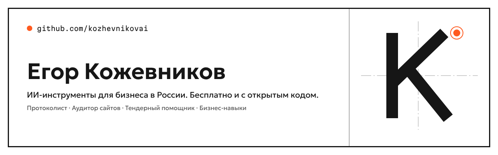

Делаю ИИ-инструменты для малого и среднего бизнеса в России. Всё бесплатно, с открытым кодом и работает на вашем компьютере: записи встреч, документы закупок и данные сайтов никуда не уходят.

## Продукты

| | Что делает | Где работает |
|---|---|---|
| **[Протоколист](https://github.com/kozhevnikovai/protokolist)** · № 003 | Записывает встречу в Zoom, Телемосте или вживую и делает протокол с решениями, задачами и сроками. Живые субтитры, «Что я пропустил?», вопросы к архиву встреч | Windows, macOS |
| **[Аудитор сайтов](https://github.com/kozhevnikovai/auditor-saitov)** · № 002 | Проверяет ваш сайт и конкурентов: SEO, путь к заявке, стиль, технологии, 152-ФЗ. Отчёт HTML, PDF, Excel | Claude Desktop, Claude Code, командная строка |
| **[Тендерный помощник](https://github.com/kozhevnikovai/tender-pomoshnik)** · № 004 | Разбирает госзакупку 44-ФЗ и 223-ФЗ: требования, сроки, обеспечение, риски — с цитатами из документов. Следит за новыми закупками | Windows, macOS |
| **[Бизнес-навыки](https://github.com/kozhevnikovai/biznes-navyki)** · № 001 | 12 навыков для Claude: КП, ответы на отзывы и претензии, письма должникам, вакансии, регламенты | Claude, Codex и другие агенты |
| [local-ai](https://github.com/kozhevnikovai/local-ai) | Движок локальных моделей Qwen3 для приложений выше | Node.js |

  
  

## Как я делаю продукты

- **Локально по умолчанию.** Модели работают на вашем ПК, облако — только если вы сами его включите.
- **Цифры считает код.** ИИ объясняет и пишет текст, а оценки, сроки и расчёты можно проверить.
- **Проверено.** Автотесты, проверки моделей на реальных данных, CI на Windows, macOS и Linux, CodeQL.

Командные версии с общими данными и сервером — скоро. Узнать первым: раздел «Скоро» в README любого продукта.
